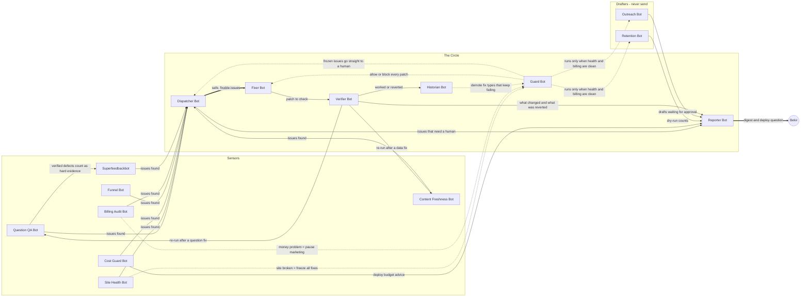

# Site Bots

Fifteen bots that watch mnaprep.com and **depend on each other**. See [[The Circle]] for how a run works and [[Guardrails]] for what they can never do.

| Bot | Role | Job |
|---|---|---|
| [[Question QA Bot]] | Sensor | Audits all 1,248 questions for wrong keys, duplicate options, giveaways. |
| [[Site Health Bot]] | Sensor | Links, function syntax, every level opens, JS errors. |
| [[Content Freshness Bot]] | Sensor | Stale wire data and guides that mention past years. |
| [[Cost Guard Bot]] | Sensor | Netlify credits (15 per deploy) and AI usage vs limits. |
| [[Funnel Bot]] | Sensor | Where visitors drop between landing and sign-up. |
| [[Billing Audit Bot]] | Sensor | Paid vs access mismatches between Stripe and the site. |
| [[Superfeedbackbot]] | Sensor | Judges user feedback with a rubric and a consensus gate. |
| [[Retention Bot]] | Drafter | Plans review-due reminders (dry run, never sends). |
| [[Outreach Bot]] | Drafter | Drafts club and career-center emails (never sends). |
| [[Dispatcher Bot]] | Circle | Dedupes issues, scores priority, routes each to the fixer, a human, or watch. |
| [[Guard Bot]] | Circle | Allows or blocks every action: kill switch, protected files, caps, loop breaker, marketing gates. |
| [[Fixer Bot]] | Circle | Applies the few fixes that are safe to automate. Everything else becomes a packet for a human. |
| [[Verifier Bot]] | Circle | Re-runs the sensor and the tests after a fix. Reverts the patch if either fails. |
| [[Historian Bot]] | Circle | Remembers which fix types worked or got reverted and demotes the ones that fail. |
| [[Reporter Bot]] | Circle | Writes the daily digest for Bekir and says when a deploy question is due. |

**Sensors** find problems. **The Circle** routes, fixes, verifies, remembers and reports. **Drafters** prepare emails and never send.

Run it all: `node tools/bots/run.mjs circle` (plan mode, changes nothing). Add `--act` to let the [[Fixer Bot]] apply safe fixes on a non-main branch.
