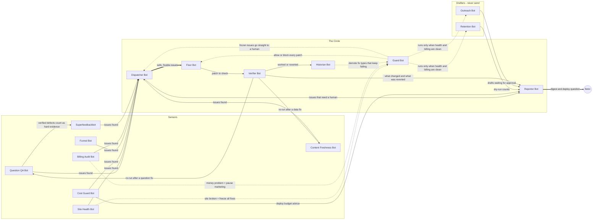

# The Circle

The bots are not independent. Each one's output is another one's input, and a few can stop others. That is what makes it a circle instead of eight scripts.

## One run, in order
1. [[Site Health Bot]] and [[Billing Audit Bot]] run first, because they can close gates.
2. [[Question QA Bot]], [[Content Freshness Bot]], [[Cost Guard Bot]] and [[Funnel Bot]] run.
3. [[Superfeedbackbot]] runs **after** QA, so a defect QA verified counts as hard evidence for a user report.
4. Every finding goes into one shared ledger (deduped, with history).
5. [[Guard Bot]] decides whether [[Retention Bot]] and [[Outreach Bot]] may run.
6. [[Dispatcher Bot]] ranks the issues and routes them.
7. In act mode only: [[Fixer Bot]] patches, [[Verifier Bot]] re-checks, and the patch is committed or reverted. [[Historian Bot]] records the result.
8. [[Reporter Bot]] writes the digest.

## Loop protection
- An issue that comes back 3 times is **frozen** and sent to a human.
- A fix is tried at most twice.
- A fix type that keeps getting reverted is demoted by the [[Historian Bot]].
- A sensor that crashes becomes a critical issue instead of silently disappearing: the circle watches itself.

## Who depends on whom
| From | Type | To | Why |
|---|---|---|---|
| [[Question QA Bot]] | feed | [[Dispatcher Bot]] | issues found |
| [[Site Health Bot]] | feed | [[Dispatcher Bot]] | issues found |
| [[Content Freshness Bot]] | feed | [[Dispatcher Bot]] | issues found |
| [[Cost Guard Bot]] | feed | [[Dispatcher Bot]] | issues found |
| [[Funnel Bot]] | feed | [[Dispatcher Bot]] | issues found |
| [[Billing Audit Bot]] | feed | [[Dispatcher Bot]] | issues found |
| [[Superfeedbackbot]] | feed | [[Dispatcher Bot]] | issues found |
| [[Question QA Bot]] | feed | [[Superfeedbackbot]] | verified defects count as hard evidence |
| [[Dispatcher Bot]] | act | [[Fixer Bot]] | safe, fixable issues |
| [[Dispatcher Bot]] | feed | [[Reporter Bot]] | issues that need a human |
| [[Guard Bot]] | gate | [[Fixer Bot]] | allow or block every patch |
| [[Site Health Bot]] | gate | [[Guard Bot]] | site broken = freeze all fixes |
| [[Billing Audit Bot]] | gate | [[Guard Bot]] | money problem = pause marketing |
| [[Guard Bot]] | gate | [[Retention Bot]] | runs only when health and billing are clean |
| [[Guard Bot]] | gate | [[Outreach Bot]] | runs only when health and billing are clean |
| [[Fixer Bot]] | feed | [[Verifier Bot]] | patch to check |
| [[Verifier Bot]] | recheck | [[Question QA Bot]] | re-run after a question fix |
| [[Verifier Bot]] | recheck | [[Content Freshness Bot]] | re-run after a data fix |
| [[Verifier Bot]] | feed | [[Historian Bot]] | worked or reverted |
| [[Historian Bot]] | learn | [[Guard Bot]] | demote fix types that keep failing |
| [[Guard Bot]] | gate | [[Dispatcher Bot]] | frozen issues go straight to a human |
| [[Cost Guard Bot]] | feed | [[Reporter Bot]] | deploy budget advice |
| [[Retention Bot]] | feed | [[Reporter Bot]] | dry-run counts |
| [[Outreach Bot]] | feed | [[Reporter Bot]] | drafts waiting for approval |
| [[Verifier Bot]] | feed | [[Reporter Bot]] | what changed and what was reverted |

Types: **feed** passes findings, **act** gives work, **gate** can block, **recheck** verifies, **learn** changes future behavior.

## What it will never do
Deploy, push to `main`, send an email, delete anything, touch the Home page, billing code or auth. See [[Guardrails]].

## First live run (Nov 25)
All 7 sensors ran with 0 failures. 7 issues opened, 0 safely fixable, so the Fixer did nothing. That is the honest result: most real problems here need a person.

| Issue | Routed to |
|---|---|
| 164 questions where the right answer is the longest option (13%) | Human |
| 859 visitors saw a guide call-to-action, 2 clicked | Human |
| 98% of 1,864 visitors never start a level | Human |
| Ticker prices 4 days old | Human |
| 79 weak distractors (6%) | Watch |
| 267 guides mention past years near recruiting words | Watch |

Daily output lands in [[Circle digest 2026-11-25]].
